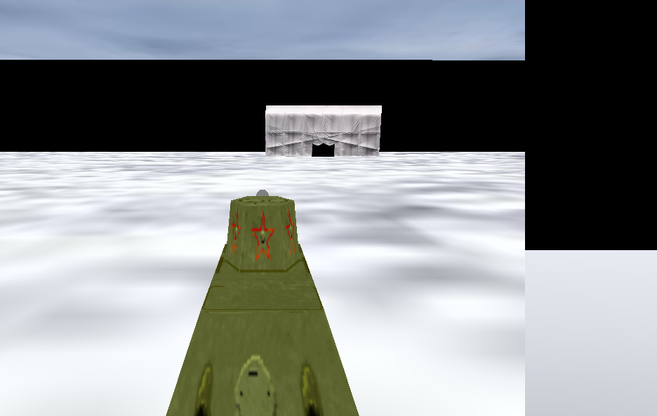

# Tank Attack

> University of Hull coursework, 2004 — module *08347 Virtual Environments and
> Advanced Graphics*, by **Richard Potter**. Modernised from C#/.NET 1.x +
> CSOpenGL to **C# / .NET 8 + OpenTK** so it builds and runs today.

A texture-mapped 3-D tank game set in a military camp. Drive a tank around a
walled arena, aim and fire its turret at nine destructible buildings (cabins,
tents, porta-cabins), and watch them explode. The view is a chase camera with a
small top-down minimap, and there are togglable fog and night-vision modes.



## Running

Requires the [.NET 8 SDK](https://dotnet.microsoft.com/download) (or newer) and an
OpenGL-capable GPU.

```bash
cd src/TankAttack
dotnet run
```

### Controls

| Input | Action |
| --- | --- |
| `W` / `Z` | drive forward / backward |
| `A` / `S` | turn the tank left / right |
| `,` / `.` | turn the turret left / right |
| `PgUp` / `PgDn` | raise / lower the gun |
| `Space` | fire a shell |
| `F1` | toggle fog |
| `F2` | toggle night-vision (green low-light) |
| `F3` | toggle night lighting |

Fire a shell into a building to destroy it.

### Headless capture

```bash
dotnet run -- --capture out.png
```

## How it works

- **`Sprite`** is the base class for everything positional and collidable
  (`TankBody`, `Shell`, `Building`), holding position, yaw, world-bounds movement
  and circle-radius collision. Each object knows how to `draw()` itself and how to
  react in `collisionEffect()` — the renderer just calls `draw()` on everything.
- **`TankBody` + `Turret`** — the hull, the rotating/elevating turret, and the
  gun barrel (two cylinders). Firing spawns a **`Shell`** (a textured sphere) that
  flies forward until it expires or hits a building.
- **`Building`** — a textured box (optionally with a pitched roof) that spawns an
  **`Explosion`** when a shell hits it.
- **`Ground`** — the floor, sky lid and surrounding cliff walls.
- **Chase camera** — the camera is fixed; the world is rotated and translated by
  the tank's yaw/position so the tank stays centred. A second pass renders the
  top-down minimap.

### Project layout

```
src/TankAttack/
  Program.cs              entry point
  TankWindow.cs           the GameWindow, render loop, lighting/fog setup, scene
  Control.cs              keyboard -> tank / turret / view actions
  Sprite.cs               base: position, yaw, movement, collision
  TankBody.cs Turret.cs Shell.cs Building.cs Explosion.cs Ground.cs
  TextureCollection.cs    PNG/JPG/BMP -> GL textures (StbImageSharp)
  Core/                   Glu (perspective/lookAt), Quadric (sphere/cylinder), Png
  Tools/                  Coord3f, Dimension3f, WorldDimensions
  Textures/               the game's texture images
docs/
  csopengl-to-opentk.md   binding migration notes
```

## Modernisation notes

The original drew through **CSOpenGL** (a binding the author's other project
report calls "incomplete and un-maintained") inside a WinForms host, and decoded
textures with `System.Drawing.Bitmap`. This port keeps the game's design and its
fixed-function rendering intact and swaps the dead plumbing for OpenTK 4 on
.NET 8. The call-by-call mapping and default-state notes are in
**[docs/csopengl-to-opentk.md](docs/csopengl-to-opentk.md)**.

Deliberate, documented changes:

- **WinForms host → `GameWindow`**; the `Main` form, `GLSurface` and `Renderer`
  collapse into one `TankWindow`. Keyboard events → per-frame input polling.
- **GLU quadrics reimplemented** (`gluSphere`/`gluCylinder`) for the shell and gun
  barrel, since OpenTK ships no GLU.
- **Textures via StbImageSharp** instead of `System.Drawing.Bitmap` — also fixes a
  latent red/blue colour swap in the original (it fed BGR pixel data to GL as RGB).
- **The explosion now grows smoothly** — the original scaled it by integer
  division, so it stayed invisible then popped to full size.
- **Aspect ratio** follows the main view instead of the original's hard-coded `1`.

The original was a finished, playable coursework game; this port preserves that,
including its quirks (e.g. the deliberately faithful, slightly-clipped minimap
viewport, and the buggy fog toggle the author themselves noted).

## Credits

By **Richard Potter** (University of Hull, 2004). Texture loading help, per the
original report, from Darren McKie (author of CSOpenGL).
